<!-- ⚠️ Generated by tools/build.py from data/profile.json + data/guestbook.json. Edit those files, not this one. -->

<picture>
  <source media="(prefers-color-scheme: dark)" srcset="assets/header-dark.svg">
  
</picture>

     


Hi, I'm **Victoria** 👋 — Cloud & AI Data Solution Engineer at **Microsoft**, based in Madrid. I help teams go from idea to a working **Data & AI** solution: architecture sessions, workshops and proofs of concept on **Microsoft Fabric** and **Microsoft Foundry**, side by side with Sales, Partners and Engineering.

> 🔎 *I measure what AI demos leave out* — quality, cost, emissions and governance included.

- 🏗️ **End-to-end Data & AI architecture** — Microsoft Fabric, Microsoft Foundry, agentic apps
- 🧪 **Workshops, proofs of concept & architecture sessions** that remove blockers
- 🌱 **Responsible & sustainable AI** — governance, bias, transparency and the energy cost of models
- 🎛️ **GenAI in the enterprise** — automation, avatars, video and audio
- 🎙️ **Speaker** at Women in Fabric 2026

<b>🎓 education.log</b> — where I learned (and keep learning)

- 🎓 **BSc Data Science & Engineering** — Universidad Carlos III de Madrid
- 🌍 **Erasmus exchange** — Politechnika Warszawska (Electronics & IT)
- 📜 **Microcredential in Responsible AI & Business Innovation** — UC3M (2025)
- 🔬 **MSc in AI Research** — UNED *(in progress, 2026–27)*

<picture>
  <source media="(prefers-color-scheme: dark)" srcset="assets/stack-dark.svg">
  
</picture>

  

  <a href="https://learn.microsoft.com/credentials/certifications/agentic-ai-business-solutions-architect/">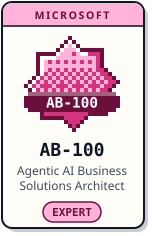</a>
  <a href="https://learn.microsoft.com/credentials/certifications/fabric-data-engineer-associate/">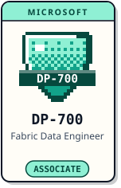</a>
  <a href="https://learn.microsoft.com/credentials/certifications/fabric-analytics-engineer-associate/">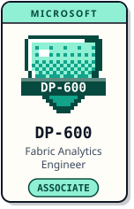</a>
  <a href="https://learn.microsoft.com/credentials/certifications/agentic-ai-developer/">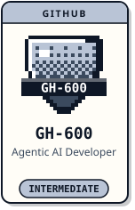</a>
  <a href="https://www.databricks.com/learn/certification/data-engineer-associate">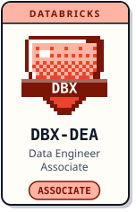</a>
  <a href="https://learn.microsoft.com/credentials/certifications/azure-ai-engineer/">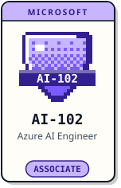</a>
   
  <a href="https://learn.microsoft.com/credentials/certifications/azure-data-scientist/">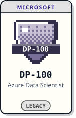</a>
  <a href="https://learn.microsoft.com/credentials/certifications/ai-transformation-leader/">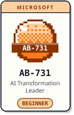</a>
  <a href="https://learn.microsoft.com/credentials/certifications/ai-business-professional/">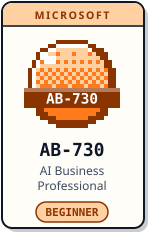</a>
  <a href="https://learn.microsoft.com/credentials/certifications/azure-fundamentals/">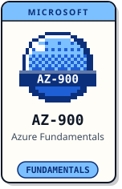</a>
  <a href="https://learn.microsoft.com/credentials/certifications/azure-ai-fundamentals/">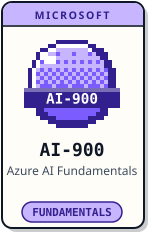</a>
  <a href="https://learn.microsoft.com/credentials/certifications/azure-data-fundamentals/">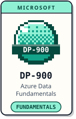</a>

Click a badge to open the official certification page

<b>📜 full_list.csv</b> — every credential, level and status

| | Credential | Issuer | Level | Status |
|---|---|---|---|---|
| **AB-100** | [Microsoft Certified: Agentic AI Business Solutions Architect Expert](https://learn.microsoft.com/credentials/certifications/agentic-ai-business-solutions-architect/) | Microsoft | Expert | Annual renewal |
| **DP-700** | [Microsoft Certified: Fabric Data Engineer Associate](https://learn.microsoft.com/credentials/certifications/fabric-data-engineer-associate/) | Microsoft | Associate | Annual renewal |
| **DP-600** | [Microsoft Certified: Fabric Analytics Engineer Associate](https://learn.microsoft.com/credentials/certifications/fabric-analytics-engineer-associate/) | Microsoft | Associate | Annual renewal |
| **GH-600** | [GitHub Certified: Agentic AI Developer](https://learn.microsoft.com/credentials/certifications/agentic-ai-developer/) | GitHub | Intermediate | In progress |
| **DBX-DEA** | [Databricks Certified Data Engineer Associate](https://www.databricks.com/learn/certification/data-engineer-associate) | Databricks | Associate | Valid 2 years |
| **AI-102** | [Microsoft Certified: Azure AI Engineer Associate](https://learn.microsoft.com/credentials/certifications/azure-ai-engineer/) | Microsoft | Associate |  |
| **DP-100** | [Microsoft Certified: Azure Data Scientist Associate](https://learn.microsoft.com/credentials/certifications/azure-data-scientist/) | Microsoft | Associate |  |
| **AB-731** | [Microsoft Certified: AI Transformation Leader](https://learn.microsoft.com/credentials/certifications/ai-transformation-leader/) | Microsoft | Beginner | Active |
| **AB-730** | [Microsoft Certified: AI Business Professional](https://learn.microsoft.com/credentials/certifications/ai-business-professional/) | Microsoft | Beginner | Active |
| **AZ-900** | [Microsoft Certified: Azure Fundamentals](https://learn.microsoft.com/credentials/certifications/azure-fundamentals/) | Microsoft | Fundamentals | No expiry |
| **AI-900** | [Microsoft Certified: Azure AI Fundamentals](https://learn.microsoft.com/credentials/certifications/azure-ai-fundamentals/) | Microsoft | Fundamentals | No expiry |
| **DP-900** | [Microsoft Certified: Azure Data Fundamentals](https://learn.microsoft.com/credentials/certifications/azure-data-fundamentals/) | Microsoft | Fundamentals | No expiry |

  <a href="https://github.com/grvic/sunchaser">
    <picture><source media="(prefers-color-scheme: dark)" srcset="assets/projects/sunchaser-dark.svg"></picture>
  </a>
  <a href="https://github.com/grvic/rag-model-analysis">
    <picture><source media="(prefers-color-scheme: dark)" srcset="assets/projects/rag-model-analysis-dark.svg"></picture>
  </a>
  <a href="https://github.com/grvic/playlist-generator">
    <picture><source media="(prefers-color-scheme: dark)" srcset="assets/projects/playlist-generator-dark.svg"></picture>
  </a>
  <a href="https://github.com/grvic/BonAppetit">
    <picture><source media="(prefers-color-scheme: dark)" srcset="assets/projects/BonAppetit-dark.svg"></picture>
  </a>

<b>📂 more public repos</b>

- [`content-understanding-demo`](https://github.com/grvic/content-understanding-demo) · Python
- [`detective-data-hack`](https://github.com/grvic/detective-data-hack) · PowerShell
- [`cards-dataset`](https://github.com/grvic/cards-dataset) · Python

<picture>
  <source media="(prefers-color-scheme: dark)" srcset="assets/talk-dark.svg">
  
</picture>

<picture>
  <source media="(prefers-color-scheme: dark)" srcset="https://raw.githubusercontent.com/grvic/grvic/output/stats-dark.svg">
  
</picture>

<picture>
  <source media="(prefers-color-scheme: dark)" srcset="https://raw.githubusercontent.com/grvic/grvic/output/snake-dark.svg">
  
</picture>

  

Click → <b>Create</b> → a friendly bot adds your avatar below and closes the issue. Only your public avatar is shown.

<!-- GUESTBOOK:START -->

No signatures yet — be the first! ✨

<!-- GUESTBOOK:END -->

<b>🐈 cats.exe</b> — meet the crew running around this page

<picture>
  <source media="(prefers-color-scheme: dark)" srcset="assets/crew-dark.svg">
  
</picture>

 

<picture>
  <source media="(prefers-color-scheme: dark)" srcset="assets/footer-dark.svg">
  
</picture>

